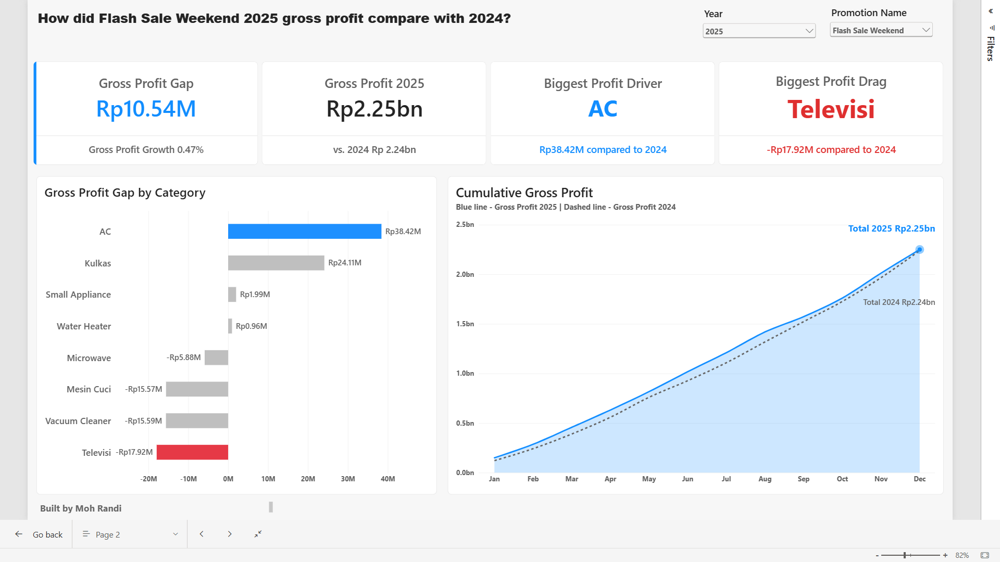

# ElectroMax Flash Sale Weekend Analysis

An end-to-end BI project: raw sales data cleaned with SQL, modeled as a star schema, and visualized in a Power BI dashboard to answer one business question.

<p align="center">
  
</p>

---

## Key Findings

Flash Sale Weekend 2025 generated a slightly higher gross profit than 2024, primarily driven by **AC**.

| Metric | Value |
|---|---|
| Gross Profit 2025 | Rp2.25bn |
| Gross Profit 2024 | Rp2.24bn |
| Gross Profit Gap | +Rp10.54M |
| Gross Profit Growth | +0.47% |
| Biggest Profit Driver | AC (+Rp38.42M vs 2024) |
| Biggest Profit Drag | Televisi / TV (-Rp17.92M vs 2024) |

**Gross profit gap by category (2025 vs 2024)**

| Category | Gap |
|---|---|
| AC | +Rp38.42M |
| Kulkas (Refrigerator) | +Rp24.11M |
| Small Appliance | +Rp1.99M |
| Water Heater | +Rp0.96M |
| Microwave | -Rp5.88M |
| Mesin Cuci (Washing Machine) | -Rp15.57M |
| Vacuum Cleaner | -Rp15.59M |
| Televisi (TV) | -Rp17.92M |

The overall gain is small because strong results in AC and Kulkas were largely offset by declines in Televisi, Vacuum Cleaner, and Mesin Cuci.

---

## Dashboard Features

- **KPI cards:** Gross Profit Gap, Gross Profit 2025 vs 2024, Biggest Profit Driver, Biggest Profit Drag.
- **Gross Profit Gap by Category:** bar chart with conditional colors. Blue marks the biggest driver, red marks the biggest drag, and gray marks everything else, so the story is visible at a glance.
- **Cumulative Gross Profit:** running total by month, with 2024 as a dashed line for pacing comparison and total labels at the end of each line.
- **Slicers:** Year and Promotion Name.

---

## Tools

| Area | Tool |
|---|---|
| Data cleaning | SQL (PostgreSQL syntax) |
| Data modeling | Star schema |
| Visualization | Power BI |
| Calculations | DAX |

---

## Data Model

Star schema with `fact_penjualan` (sales transactions) at the center.

| Table | Role | Total Rows | Key columns |
|---|---|---|---|
| `fact_penjualan` | Fact | 56748 | `kuantitas`, `harga_satuan`, `total_harga`, `diskon_persen`, `diskon_nominal`, `total_neto`, `hpp`, `gross_profit`, `metode_bayar`, `status_transaksi` |
| `dim_produk` | Dimension | 30 | `produk_id`, `nama_produk`, `kategori`, `subkategori`, `merek`, `harga_normal`, `harga_pokok` |
| `dim_promosi` | Dimension | 18 | `promosi_id`, `nama_promosi`, `tipe_promosi`, `nilai_diskon_pct`, `tgl_mulai`, `tgl_selesai` |
| `dim_waktu` | Dimension | 1096 | `waktu_id`, `tanggal`, `bulan`, `nomor_bulan`, `kuartal`, `tahun`, `is_weekend` |

The fact table also holds keys to customer (`pelanggan_id`), store (`toko_id`), and employee (`karyawan_id`) dimensions.

---

## Data Cleaning (SQL)

The raw tables were stored as text and contained inconsistent values, so each table was cleaned before modeling.

| Table | Issues found | Cleaning applied |
|---|---|---|
| `fact_penjualan` | Currency stored as text (`Rp`, thousand separators); inconsistent payment method and transaction status labels | Stripped `Rp` and `.`, cast to `integer`/`bigint`, standardized labels with `CASE WHEN` (e.g. `q-ris`/`qris` to `QRIS`, `retur`/`return` to `Dikembalikan`) |
| `dim_promosi` | Placeholder `—` in promo type; numbers and dates stored as text | Replaced `—` with `Tanpa Promosi`, cast numeric columns, converted dates with `to_date` |
| `dim_produk` | Quotes in product names; missing `subkategori`; currency as text; duplicate rows | Trimmed and removed quotes, filled missing subcategory from product name (`TV`, `Microwave`), cast prices, deduplicated with `ROW_NUMBER()` |
| `dim_waktu` | Dates, numbers, and `Ya`/`Tidak` flags stored as text | Converted dates, cast to `integer`, mapped `Ya`/`Tidak` to `1`/`0` |

<details>
<summary><b>fact_penjualan</b></summary>

```sql
WITH data_clean AS (
    SELECT
        fact_penjualan.penjualan_id::integer AS penjualan_id,
        fact_penjualan.produk_id::integer AS produk_id,
        fact_penjualan.waktu_id::integer AS waktu_id,
        fact_penjualan.pelanggan_id::integer AS pelanggan_id,
        fact_penjualan.toko_id::integer AS toko_id,
        fact_penjualan.karyawan_id::integer AS karyawan_id,
        fact_penjualan.promosi_id::integer AS promosi_id,
        fact_penjualan.kuantitas::integer AS kuantitas,
        replace(replace(fact_penjualan.harga_satuan, '.'::text, ''::text), 'Rp'::text, ''::text)::bigint AS harga_satuan,
        fact_penjualan.total_harga::integer AS total_harga,
        fact_penjualan.diskon_persen::integer AS diskon_persen,
        replace(fact_penjualan.diskon_nominal, '.'::text, ''::text)::bigint AS diskon_nominal,
        replace(fact_penjualan.total_neto, '.'::text, ''::text)::bigint AS total_neto,
        replace(fact_penjualan.hpp, '.'::text, ''::text)::integer AS hpp,
        fact_penjualan.gross_profit::integer AS gross_profit,
        CASE
            WHEN lower(TRIM(BOTH FROM fact_penjualan.metode_bayar)) = ANY (ARRAY['q-ris'::text, 'qris'::text]) THEN upper('QRIS'::text)
            WHEN lower(TRIM(BOTH FROM fact_penjualan.metode_bayar)) = ANY (ARRAY['cicilan'::text, 'cc'::text, 'cicilan 0 persen'::text, 'cicilan 0%'::text]) THEN initcap('cicilan 0%'::text)
            WHEN lower(TRIM(BOTH FROM fact_penjualan.metode_bayar)) = ANY (ARRAY['kartu kredit'::text, 'k. kredit'::text, 'credit card'::text, ''::text]) THEN initcap('kartu kredit'::text)
            WHEN lower(TRIM(BOTH FROM fact_penjualan.metode_bayar)) = ANY (ARRAY['transfer bank'::text, 'transfer'::text]) THEN initcap('transfer bank'::text)
            WHEN lower(TRIM(BOTH FROM fact_penjualan.metode_bayar)) = ANY (ARRAY['cash'::text, 'tunai'::text]) THEN initcap('tunai'::text)
            ELSE fact_penjualan.metode_bayar
        END AS metode_bayar,
        CASE
            WHEN lower(TRIM(BOTH FROM fact_penjualan.status_transaksi)) = ANY (ARRAY['selesai'::text, 'done'::text, 'sukses'::text, 'complete'::text]) THEN initcap('selesai'::text)
            WHEN lower(TRIM(BOTH FROM fact_penjualan.status_transaksi)) = ANY (ARRAY['dikembalikan'::text, 'retur'::text, 'return'::text]) THEN initcap('dikembalikan'::text)
            WHEN lower(TRIM(BOTH FROM fact_penjualan.status_transaksi)) = 'pending'::text THEN initcap('ditunda'::text)
            ELSE fact_penjualan.status_transaksi
        END AS status_transaksi
    FROM fact_penjualan
)
SELECT
    penjualan_id, produk_id, waktu_id, pelanggan_id, toko_id, karyawan_id,
    promosi_id, kuantitas, harga_satuan, total_harga, diskon_persen,
    diskon_nominal, total_neto, hpp, gross_profit, metode_bayar, status_transaksi
FROM data_clean;
```

</details>

<details>
<summary><b>dim_promosi</b></summary>

```sql
CREATE VIEW clean_dim_promos AS
SELECT
    promosi_id::integer,
    kode_promosi,
    nama_promosi,
    replace(tipe_promosi, '—', 'Tanpa Promosi') AS tipe_promosi,
    nilai_diskon_pct::integer,
    replace(min_pembelian, '.', '')::integer AS min_pembelian,
    to_date(tgl_mulai, 'YYYY-MM-DD') AS tgl_mulai,
    to_date(tgl_selesai, 'YYYY-MM-DD') AS tgl_selesai,
    is_aktif::integer
FROM dim_promosi;
```

</details>

<details>
<summary><b>dim_produk</b></summary>

```sql
WITH clean_tabel AS (
    SELECT
        produk_id::integer,
        kode_produk,
        replace(trim(nama_produk), '"', '') AS nama_produk,
        kategori,
        subkategori,
        upper(merek) AS merek,
        tipe,
        replace(ukuran, '—', '') AS ukuran,
        watt,
        warna,
        garansi_tahun,
        replace(replace(trim(harga_normal), 'Rp', ''), '.', '')::integer AS harga_normal,
        replace(replace(trim(harga_pokok), 'Rp', ''), '.', '')::integer AS harga_pokok,
        status_aktif::integer
    FROM dim_produk
),
manipulasi_data AS (
    SELECT
        *,
        CASE
            WHEN subkategori ISNULL AND nama_produk ILIKE '%TV%' THEN 'TV'
            WHEN subkategori ISNULL AND nama_produk ILIKE '%Microwave%' THEN 'Microwave'
            ELSE subkategori
        END AS subkategori
    FROM clean_tabel
),
get_unik AS (
    SELECT
        *,
        row_number() OVER (PARTITION BY produk_id ORDER BY produk_id) AS rn
    FROM manipulasi_data
)
SELECT *
FROM get_unik
WHERE rn = 1;
```

</details>

<details>
<summary><b>dim_waktu</b></summary>

```sql
SELECT
    waktu_id::integer AS waktu_id,
    to_date(tanggal, 'yyyy-mm-dd'::text) AS tanggal,
    hari,
    nomor_hari::integer AS nomor_hari,
    minggu_ke::integer AS minggu_ke,
    bulan,
    nomor_bulan::integer AS nomor_bulan,
    kuartal,
    semester,
    tahun::integer AS tahun,
    replace(replace(is_weekend, 'Tidak'::text, '0'::text), 'Ya'::text, '1'::text)::integer AS is_weekend,
    is_harbol::integer AS is_harbol,
    is_libur_nasional::integer AS is_libur_nasional
FROM dim_waktu;
```

</details>

---

## DAX Highlights

**Cumulative (running total) gross profit.** Each month shows the total from January up to that month, so the line never drops and ends at the full-period total.

```dax
cumulative gross profit 2025 =
VAR _bulanIni = MAX('clean_dim_waktu'[nomor_bulan])
RETURN
CALCULATE(
    [Gross Profit Flash Sale],
    FILTER(
        ALLSELECTED('clean_dim_waktu'),
        'clean_dim_waktu'[nomor_bulan] <= _bulanIni
    )
)
```

The 2024 line uses the same logic with `[Gross Profit Flash Sale Previous]`.

**End-of-line label.** Returns a value only in the last month, so the data label and marker appear at the end of the line and nowhere else.

```dax
label total 2025 =
VAR _bulanTerakhir = CALCULATE(MAX('clean_dim_waktu'[nomor_bulan]), ALLSELECTED('clean_dim_waktu'))
VAR _bulanIni = MAX('clean_dim_waktu'[nomor_bulan])
RETURN
IF(_bulanIni = _bulanTerakhir, [cumulative gross profit 2025])
```

---

## Design Decisions

- **Headline is the question.** The dashboard title is the business question, and the KPI cards answer it directly.
- **Color carries meaning.** Blue is reserved for positive and focus items, red for the biggest drag, gray for the rest.
- **Cumulative view for pacing.** A running total shows how quickly each year builds toward its final figure, instead of noisy month-to-month swings.
- **Direct labeling.** Totals sit at the end of each line, so readers do not need to look back at the axis.

---

## Limitations

- The analysis **compares 2025 with 2024**; it does not isolate the effect of the discount itself. Volume, pricing, product mix, and promotion length can all differ between years.
- The +0.47% gap is small, so "slightly higher" is the safest reading rather than a clear improvement.

## Project Files

| File | Description |
| --- | --- |
| [`Dashboard Electromax Report.pbix`](Dashboard%20Electromax%20Report.pbix) | Power BI dashboard containing the data model, DAX measures, and visual analysis. |
| [`ElectroMax.xlsx`](ElectroMax.xlsx) | Raw sales dataset used as the source for the analysis. |
